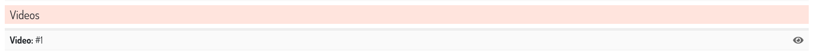

Collapsable StackedInline entries
=========

Baton lets you collapse single stacked inline entries, just add a `collapse-entry` class to the inline, with or without the entire collapse class ::

    class VideosInline(admin.StackedInline):
        model = Video
        extra = 1
        classes = ('collapse-entry', )  # or ('collapse', 'collapse-entry', )

The forms of the new entries (the ``extra`` ones and the ones added with the "Add another" button) stay expanded, the existing entries are collapsed.

And if you want the first entry to be initially expanded, add also the `expand-first` class ::

    class VideosInline(admin.StackedInline):
        model = Video
        extra = 1
        classes = ('collapse-entry', 'expand-first', )
