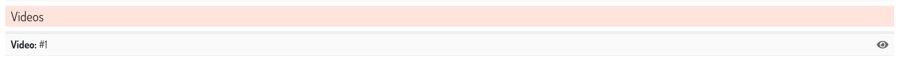

Collapsable StackedInline entries
=================================

Every stacked inline entry has a header with its name, a plain-text summary of
its fields, a toggle to open and close its form and a menu of actions to
delete or restore it. The form widgets and
Django permissions are preserved, and every change is saved with the parent
form.

To have the existing entries collapsed when the page opens, add a
``collapse-entry`` class to the inline, with or without the entire collapse
class ::

    class VideosInline(admin.StackedInline):
        model = Video
        extra = 1
        classes = ('collapse-entry', )  # or ('collapse', 'collapse-entry', )

Without it, all the entries start expanded. The forms of the new entries (the
``extra`` ones and the ones added with the "Add another" button) and the
entries with validation errors always start expanded.

And if you want the first entry to be initially expanded, add also the
``expand-first`` class ::

    class VideosInline(admin.StackedInline):
        model = Video
        extra = 1
        classes = ('collapse-entry', 'expand-first', )

Tabular inlines
---------------

Tabular inlines keep their table, with the same look and the same actions:
the name of a saved entry is shown on top of its cells, and a menu at the end
of the row deletes or restores it, in place of the "Delete?" column and of the
remove button of the new entries.

Ordering
--------

When a stacked or tabular inline has an editable numeric ``position``,
``sort_order`` or ``order`` field, that field is hidden and a handle lets users
drag the entries or move them with the Up/Down arrow keys.
The menu also offers Move up and Move down. The model must use that field
in its ordering for the order to persist across visits.
Untouched extra forms are excluded from ordering to avoid empty records.

Rows are dragged with SortableJS and move in the page, as the keyboard and
the menu move them. A moved row reloads the widgets it holds in iframes, such
as rich text editors: an editor that keeps its value in the form field as it
changes, as django-editor-js does since 0.9.1, loses nothing; one that writes
it only when the form is submitted loses the unsaved text of that row.
